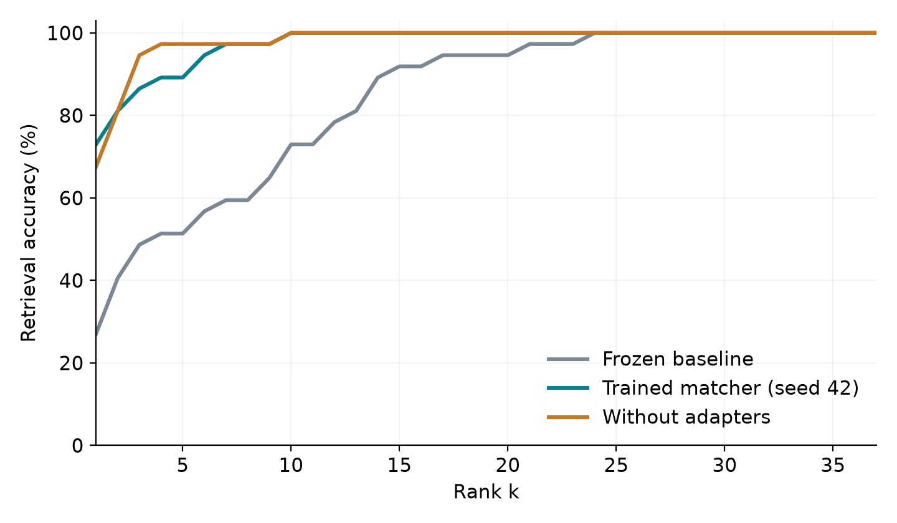

# Sketch2Face

Match a face sketch to candidate photos using a trained cross-modal embedding model, and measure rank-1, rank-5, and rank-10 retrieval accuracy.

**Dataset scope:** the downloaded public CUFS mirror contains **188 usable CUHK sketch–photo pairs**, not the complete 606-pair CUFS benchmark described on its listing. Experiments use only these verified pairs. CUFS consists of artist sketches made while viewing photos; this project does not establish accuracy on eyewitness or composite forensic sketches.

## Measured results

All 37 held-out sketches search the same gallery of 37 held-out photos.

| Model | Rank-1 | Rank-5 | Rank-10 |
|---|---:|---:|---:|
| Frozen pretrained baseline | 27.03% | 51.35% | 72.97% |
| Trained matcher, primary seed 42 | **72.97%** | **89.19%** | **100.00%** |

Across three training seeds, rank-1 averages **69.37% ± 3.12 percentage points** (sample standard deviation). These are measurements on a small custom subset protocol, not full-CUFS or real-world forensic accuracy.



Download the [college report](outputs/academic/project_report.pdf), [IEEE-style paper](outputs/academic/research_paper.pdf), [presentation](outputs/academic/presentation.pptx), and [viva guide](outputs/academic/viva_guide.md). Editable Word files and presentation speaker notes are in [the academic folder](outputs/academic).

## Watch the website demo

[Watch the captioned demo video](docs/demo/sketch2face-demo.mp4) · [Demo walkthrough and recording notes](docs/demo/README.md). The video shows sample search, sketch upload, a custom photo gallery, ranked results, and JSON export. Dataset images are hidden in the public copy; the full local copy is at `tmp/demo/sketch2face-demo-full.mp4`.

## Run the website

Python 3.11–3.13 is required. The current workspace contains the dataset, trained checkpoints, and experiment outputs after the experiment script completes.

```bash
uv sync --extra dev --extra documents
uv run uvicorn sketch2face.web:app --host 127.0.0.1 --port 8000
```

Open **http://localhost:8000**. Upload a sketch or click **Try a sample**, choose the built-in gallery or **My own photos**, then click **Find matching faces**. You get the top candidate, alternative matches, cosine similarities, and a JSON export. The built-in gallery contains all 37 held-out photos; custom galleries accept up to 200 candidate images.

See the [website and upload API guide](docs/website.md). Interactive API documentation is at `/docs`, with the contract at `/openapi.json` and [a saved copy](docs/website-openapi.json). The earlier Streamlit demo remains available with `uv run streamlit run app.py`.

The main checkpoint is `runs/matcher/best.pt`. Scores are cosine similarities, not probabilities or evidence of identity. Upload tightly cropped, aligned faces; the app does not detect or align faces automatically.

## Reproduce the experiments

```bash
uv sync --extra dev --extra documents
uv run python scripts/download_cufs.py
uv run python scripts/run_experiments.py
uv run python scripts/make_figures.py
uv run python scripts/build_academic.py
```

The academic builder uses python-docx, python-pptx, and reportlab (installed by `--extra documents`). It creates editable documents and a deck; PDF export of Office files needs LibreOffice. Regenerate the report and paper after changing experiments. See [the reproduction guide](docs/reproduction.md).

The downloader records the Kaggle dataset version, URL, archive SHA-256, original-author rights notice, filename mapping, and excluded files in `data/provenance.json`. It creates a frozen manifest with seed 42 and **114 train / 37 validation / 37 test identities**. It extracts only `photos/` and `sketches/`; extra unpaired sketches and duplicate original-resolution files are excluded. Dataset files and model weights are ignored by Git. Original authors retain their rights; public download availability does not grant permission to redistribute the data.

The experiment script runs this fixed matrix:

| Experiment | Description |
|---|---|
| `baseline` | Frozen ImageNet-pretrained ResNet-18, raw normalized 512-D features |
| `matcher` | Modality adapters + shared ResNet-18 + 256-D projection, seed 42 |
| `matcher_seed43` | Same model and split, training seed 43 |
| `matcher_seed44` | Same model and split, training seed 44 |
| `shared_input` | Same training as seed 42, adapters disabled |

All trained runs use 20 epochs. The first three freeze the backbone; later epochs fine-tune layer 4. BatchNorm statistics remain frozen. Checkpoints maximize validation rank-1, breaking ties with validation mean reciprocal rank. Test evaluation occurs after all runs finish. Existing completed runs are reused; use new output paths for new experiments.

## Read the findings

- `outputs/results/summary.json`: all runs, three-seed mean/sample standard deviation, paired bootstrap improvement interval.
- `outputs/results/matcher/report.md`: primary rank-k report and confidence intervals.
- `outputs/results/*/metrics.json`: gallery sizes, rank-k accuracy, CMC, model settings, selected epoch, and provenance.
- `outputs/results/*/retrievals.json`: individual sketch queries, correct ranks, and top candidates.
- `outputs/figures/`: comparison plots, learning curves, and image examples.
- `outputs/academic/`: college project report, IEEE-style paper, presentation, and viva guide.

Per-query 95% bootstrap intervals measure uncertainty within this small fixed test set. Variation across training seeds is reported separately. The 37-photo gallery is much smaller than a realistic deployment gallery; do not compare these values directly with papers using other datasets, protocols, or gallery sizes.

## Use the command line

```bash
uv run sketch2face --help
uv run sketch2face baseline --output runs/new_baseline
uv run sketch2face train --output runs/new_matcher --epochs 20
uv run sketch2face evaluate --checkpoint runs/new_matcher/best.pt --output runs/new_matcher/test
uv run sketch2face match --checkpoint runs/matcher/best.pt --sketch data/cufs/CUHK/sketches/f-005-01.jpg --gallery data/cufs/CUHK/photos --output runs/my_matches.json
```

The last command illustrates general gallery search; it searches all available photos, including training photos, so it is **not a held-out evaluation**. Use `evaluate` for benchmark measurements.

Automatic device selection prefers CUDA, then Apple MPS, then CPU. Override with `--device cpu`, `--device mps`, or `--device cuda`. The first pretrained run downloads official torchvision ResNet-18 weights. `--no-pretrained` is provided for offline pipeline tests; it is not equivalent to the pretrained setup.

## Add the remaining CUFS sources

Obtain AR and XM2VTS pairs through the dataset owners' access procedures, then create this layout with matching identity stems:

```text
data/full_cufs/
  CUHK/photos/identity.jpg
  CUHK/sketches/identity.jpg
  AR/photos/identity.jpg
  AR/sketches/identity.jpg
  XM2VTS/photos/identity.jpg
  XM2VTS/sketches/identity.jpg
```

```bash
uv run sketch2face prepare --root data/full_cufs --output data/full_manifest.json --dataset-label "CUFS full verified pairs"
uv run sketch2face train --manifest data/full_manifest.json --output runs/full_matcher
uv run sketch2face evaluate --manifest data/full_manifest.json --checkpoint runs/full_matcher/best.pt --output runs/full_matcher/test
```

For inconsistent naming, use a CSV with `identity,source,sketch,photo` columns and `prepare --input-csv mapping.csv`. Image paths are relative to the CSV. Pairing is never inferred from file order. Source labels namespace identities; use consistent labels and audit any person appearing across sources manually. One pair per identity is required.

Preparation rejects duplicate decoded pixels, repeated identities, missing pairs, small/corrupt images, and insufficient training data. The loader verifies image SHA-256 values. Checkpoints must match the manifest fingerprint. A saved manifest is never silently overwritten. Absolute paths in the manifest must be regenerated if the dataset moves; retrain against the new manifest.

## Verify the project

```bash
uv run pytest -q
uv run ruff check sketch2face scripts tests app.py
```

Tests cover known ranks, shuffled galleries, pessimistic score ties, missing matches, invalid scores, deterministic identity splits, duplicate/changed images, contrastive gradients, checkpoint loading, and the demo workflow.

## Project map

| Path | Purpose |
|---|---|
| `sketch2face/data.py` | Image preprocessing, pair audit, manifests, datasets |
| `sketch2face/model.py` | Adapters, ResNet-18, projection, contrastive objective |
| `sketch2face/engine.py` | Training, checkpoint selection, evaluation, inference |
| `sketch2face/metrics.py` | Rank-k, CMC, MRR, bootstrap intervals |
| `sketch2face/cli.py` | Prepare / baseline / train / evaluate / match commands |
| `app.py` | Local upload and dataset demonstration interface |
| `scripts/` | Data acquisition, experiments, figures, academic artifacts |
| `docs/` | Architecture, protocol, reproduction, viva material |
| `outputs/` | Measured results, plots, paper, report, presentation |

See [architecture](docs/architecture.md), [evaluation protocol](docs/evaluation.md), and [reproduction](docs/reproduction.md).
