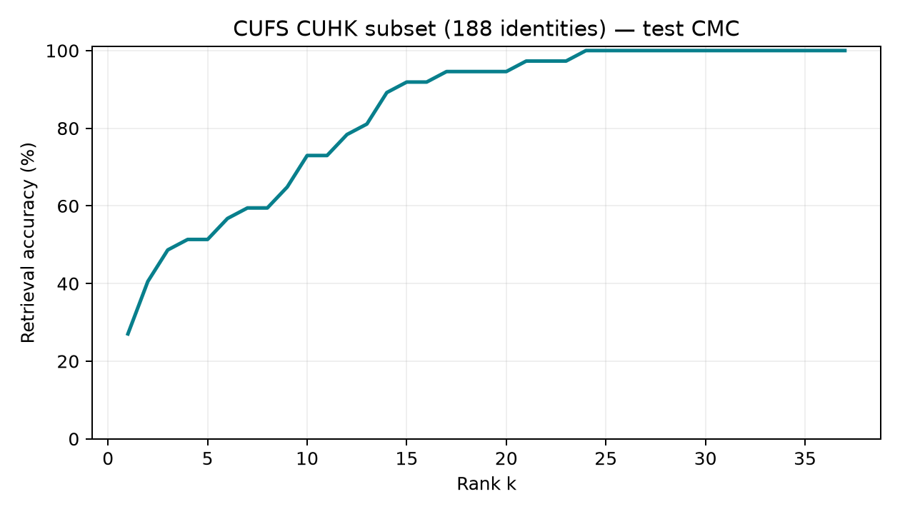

# CUFS CUHK subset (188 identities) retrieval accuracy report

Split: test. Queries: 37. Gallery: 37 photos.

| Gallery | Rank-1 | Rank-5 | Rank-10 |
|---|---:|---:|---:|
| Pooled (n=37) | 27.0% [13.5%, 43.2%] | 51.4% [35.1%, 67.6%] | 73.0% [56.8%, 86.5%] |
| CUHK (n=37) | 27.0% [13.5%, 43.2%] | 51.4% [35.1%, 67.6%] | 73.0% [56.8%, 86.5%] |

Intervals are 95% percentile bootstrap intervals over query identities (2,000 resamples).
Per-source galleries contain only that source; their difficulty differs from the pooled gallery.
Tied distractors count ahead of the correct photo. Closed-set: every query has one gallery match.

Face-image examples are retained locally and can be inspected in the Streamlit demo; they are excluded from this public repository.

Selected epoch: 0. Pretraining: torchvision ResNet18 IMAGENET1K_V1.
Manifest SHA-256: `34f06671f50fba99fe89dda92c0dd066f3972291a20570e26aa46c72e224a41b`.
Checkpoint SHA-256: `56ac07b5359f93cacdc99c366af8ecf1e571034431f0320b3ef2e970591b7a3c`.

CUFS uses viewed artist sketches. These measurements do not validate eyewitness or composite sketches.
External pretraining overlap is not independently audited; scores are similarities, not identity probabilities.
